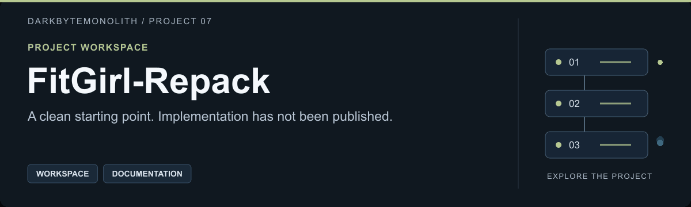
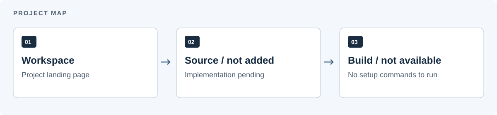

<!-- readme-design:start -->

  <picture>
    <source media="(prefers-reduced-motion: reduce)" srcset="docs/readme/hero.svg" />
    
  </picture>

  
  

<a href="#repository-status">Repository status</a> · <a href="#next-steps">Next steps</a>

<table>
  <tr>
    <td width="33%" valign="top"><b>Repository</b> Initial project documentation.</td>
    <td width="33%" valign="top"><b>Implementation</b> No source is committed yet.</td>
    <td width="33%" valign="top"><b>Status</b> No runnable setup is available.</td>
  </tr>
</table>

<!-- readme-design:end -->

## Repository status

This repository was empty before this documentation was added. It currently contains only this README and its visual assets.

No application source, installer, download catalogue, or build instructions are included. This page does not claim that a working release exists.

## Next steps

Add the project source, its license, and verified setup instructions before documenting executable commands.
